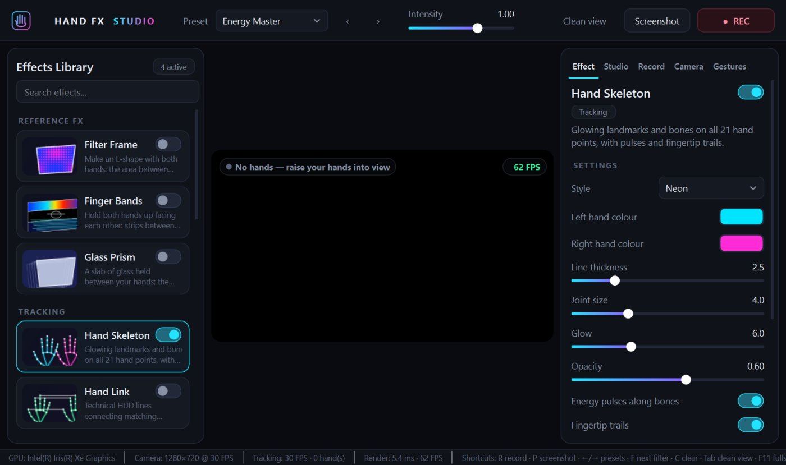
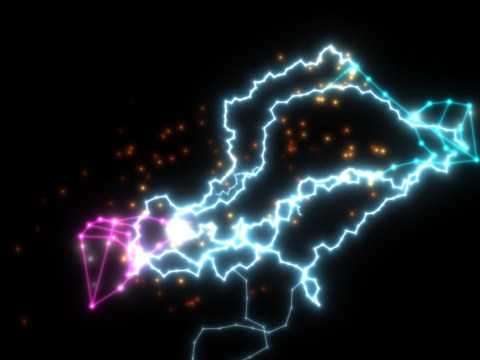
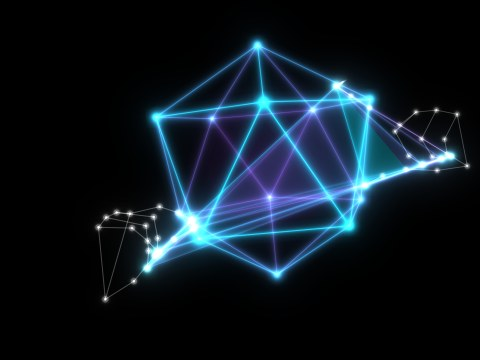
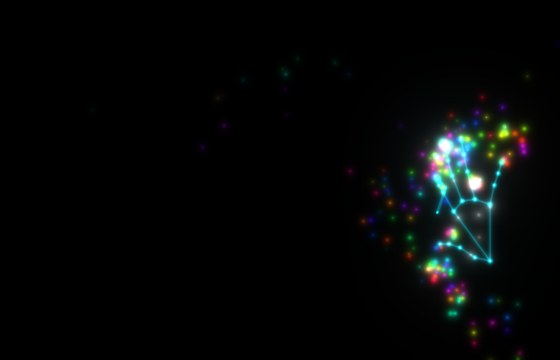
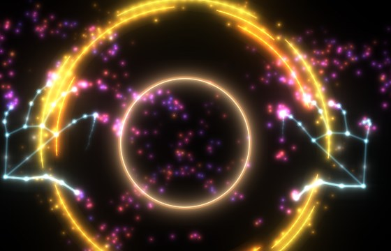

# HAND FX STUDIO

**Real-time hand-tracking visual effects for Windows.** Stand in front of your webcam, move your
hands, and bend, filter, electrify and shatter the world around you — then record it as a
TikTok-ready MP4.

Everything runs locally: no accounts, no cloud, no subscriptions.



| Energy | Sacred Geometry |
|---|---|
|  |  |
| **Particles** | **Portal** |
|  |  |

*(Showcase images rendered with the camera image hidden, so only the effects are visible.)*

---

## Quick start

1. Install **Python 3.12** from [python.org](https://www.python.org/downloads/) — tick
   *"Add python.exe to PATH"* during installation. *(Already installed on this PC.)*
2. Double-click **`start.bat`**.
   - The first launch creates a private Python environment and installs everything
     (a few minutes). The hand-tracking model (≈8 MB) is downloaded automatically.
   - Later launches start in a few seconds.
3. Raise your hands into view and play. Pick a preset from the top bar or press **← / →**.

> The Python environment is stored in `%LOCALAPPDATA%\HandFXStudio\venv` (outside OneDrive,
> so syncing never locks files). Delete that folder to force a clean reinstall.

---

## How to play

| Gesture | What it does |
|---|---|
| **L-shape with both hands** (thumbs + index fingers) | Opens the **Filter Frame** / **Glass Prism** lens between your hands |
| **Touch all four fingertips together, then reopen** | Closes the frame → switches to the next filter |
| **Hold the frame still ~1 s** *(ring fills up)* | **Pins** the filter frame in the air — it stays while you make new ones |
| **Pinch inside a pinned frame** and move | Drags the pinned frame somewhere else |
| **Point at a pinned frame** for 0.6 s | Changes that frame's filter |
| **Hold two fists** for 1 s | Clears all pinned frames |
| **Pinch** (thumb + index) | Magnifying lens bubble, plasma orb, gathers particles — strength follows how closed the pinch is |
| **Open palm** | Energy field, one-hand portal, pushes particles away, palm mandala |
| **Close your fist** | Shockwave through the image + particle explosion |
| **Bring both hands together** | Big shockwave |
| **Move hands apart** | Grows portals, the 3D geometry and the frame |
| **Rotate your wrist** | Spins the kaleidoscope, twists space, sweeps hue |
| **Point both index fingers at each other** | Energy beam |
| **Peace sign** | Jumps the colour palette |
| **Move fast** | Energy trails, RGB split, more particles |
| **Hold thumbs up (1.2 s)** | Next preset *(configurable in the Gestures tab)* |
| **Hold rock / horns (0.8 s)** | Next frame filter *(configurable)* |

### Keyboard shortcuts
`R` record · `P` screenshot · `←`/`→` previous/next preset · `1`–`9` presets · `F` next filter ·
`C` clear particles & trails · `Space` pin frame · `Backspace` remove last pin · `Delete` clear pins ·
`Tab` clean view (hide panels) · `F11` fullscreen · `Esc` exit fullscreen/clean view

---

## Effects

All effects can run at the same time and every one has its own settings (click a card in the
Effects Library). Effects are layered: image effects transform the camera picture in order, then
glowing overlays are drawn on top. Reorder layers in the **Studio** tab.

| Category | Effect | Description |
|---|---|---|
| Reference FX | **Filter Frame** | Polygon between thumbs & index fingers with 16 stylised filters: duotone halftone, pixel mosaic (with pixel-stepped outline), negative, thermal, rainbow heat, edge sketch, scanline glitch, cyan/magenta dot screens, dream blur, pop art, glass, X-ray, LED matrix, RGB glitch, mirror world. Works with one hand too (fingertip lens). |
| Reference FX | **Finger Bands** | Strips between matching fingertips of both hands, each a different layer of reality (thermal / edge sketch / scanlines / rainbow). |
| Reference FX | **Glass Prism** | A slab of glass between your hands: bright refracted interior, dimmed blue world, trailing echo frames and prism glints. |
| Tracking | **Hand Skeleton** | All 21 landmarks with Neon, Classic, Minimal, Plasma and Hologram styles, energy pulses and fingertip trails. |
| Tracking | **Hand Link** | HUD lines connecting matching fingertips of both hands with travelling data packets. |
| Distortion | **Liquid Space** | Drag the image like liquid — a GPU fluid-like displacement field with chromatic fringes. |
| Distortion | **Finger Lens** | Pinch lens, fingertip bulges, black hole, wrist twist, ripples. |
| Distortion | **Shockwaves** | Expanding distortion rings from fists, claps and palm bursts. |
| Distortion | **Kaleidoscope** | Mirror segments centred between your hands; fingers add segments, wrist spins it. |
| Portals | **Portal** | Vortex tunnel / kaleido world / inverted / thermal dimension between your hands, with rotating rings, rim sparks and space bending. |
| Colour | **Colour Shift** | Hue by wrist rotation or hand height, psychedelic flow, posterise, negative / hue-flip / thermal zones around palms, RGB split on fast moves. |
| Particles | **Particle Field** | Thousands of glowing particles: Neon, Fire, Sparks, Stardust, Vortex, Rainbow, Plexus. Attraction, repulsion, explosions, hand-to-hand flow. |
| Energy | **Energy** | Lightning between hands, arcs in a pinch, plasma orbs, palm fields, beams, speed trails. |
| Geometry | **Sacred Geometry** | Fingertip web, glowing facets, 3D wireframe solids (icosahedron, geodesic sphere, cube, octahedron), palm mandalas, mirror symmetry. |

### Presets
Filter Frame · Pin Studio · Finger Bands · Glass Prism · Tracking HUD · Reality Bender · Energy Master ·
Portal · Sacred Geometry · Psychedelic · Neon Particles · Total Chaos · Clean Camera

The first four recreate the four reference videos (see [REFERENCE_ANALYSIS.md](REFERENCE_ANALYSIS.md)).
Your changes to effects are remembered between sessions.

---

## Recording videos

Open the **Record** tab (or press `R`).

- **Format:** 16:9 (YouTube), **9:16 vertical (TikTok / Reels / Shorts)**, **Story (Instagram Story,
  always 1080×1920; the HUD stays clear of the zones Instagram covers with its profile bar and reply
  box, and the preview shades those zones)**, 1:1 (square)
- **Resolution:** 720p or 1080p · **Frame rate:** 24 / 30 / 60 · **Quality** slider
- **Smart framing:** in 9:16 and 1:1 the crop window glides to keep your hands in shot
- **Crop guide:** the preview shades what will be cut off in vertical/square mode
- The video contains the **final composition with all effects**, encoded as H.264 MP4
  (plays on phones and uploads directly to TikTok/Instagram/YouTube).
- **Cinematic HUD** (on by default): recordings get a sci-fi heads-up display baked in — target
  reticles and data cards on each hand (gesture, confidence, pinch/spread/openness, wrist angle,
  fingertip XYZ), a rangefinder between your hands, live SYSTEM stats (FPS, render/inference time,
  camera rate, GPU), ACTIVE FX list, pinned-frame tags, motion-energy graphs, a radar, a scrolling
  event log, REC timecode with frame counter, and glitch callouts for big moments (SHOCKWAVE,
  PINNED, FILTER changes). Styles: **Cyber**, **Military**, **Synthwave**; detail **Full** or
  **Minimal**. The HUD is laid out separately for 9:16 vertical video and shows in the preview while
  recording (or always, if you switch that on).
- **3-2-1 countdown** before recording starts (press `R` again to cancel).
- Default folder: `Videos\HandFXStudio` (screenshots go in `Videos\HandFXStudio\Screenshots`).
  After recording, the Record tab shows a preview with **Play** and **Show in folder** buttons.

---

## Settings

- **Studio tab:** presets, master intensity, background darkening, glow (bloom), show/hide
  camera image, render quality, layer order.
- **Camera tab:** choose camera (**Detect** scans all cameras), resolution, mirroring, tracking
  smoothing, sensitivity, tracking resolution (speed vs accuracy), low-light boost, live stats.
- **Gestures tab:** live readout of each hand (gesture, pinch, spread, openness), two-hand
  distance, gesture shortcut assignments, quick how-to.

---

## Troubleshooting

| Problem | Fix |
|---|---|
| *"Camera not available"* | Close other apps that use the camera (Zoom, Teams, Camera app). Check **Windows Settings → Privacy & security → Camera** allows desktop apps. Try another camera in the **Camera** tab → **Detect** → **Apply**. |
| Hands not detected / flickering | Light your hands from the front; avoid a bright window **behind** you. Turn on **Low-light boost**. Keep hands 50–150 cm from the camera. Raise *Detection sensitivity*. |
| Camera runs at ~15 FPS | Most webcams halve their frame rate in dim rooms (longer exposure). Add light. |
| Effects lag behind hands | Lower *Smoothing* in the Camera tab. |
| Low FPS | Studio tab → Render quality **low**; Camera tab → Tracking resolution **Fast**; use 720p camera resolution; fewer simultaneous effects. |
| *"Could not create an OpenGL 3.3 context"* | Update your graphics driver from Intel / AMD / NVIDIA. |
| Model download fails on first run | Check internet, or download `hand_landmarker.task` manually (URL in the error) into `assets\models\`. |
| Something broke after changing settings | Run `start.bat --reset` (resets settings) or `start.bat --safe` (starts with no effects). |
| Console shows `INFO`/`W0000` lines from MediaPipe | Harmless log messages from the tracking library. |
| Crash or error dialog | Details are in `hand_fx_studio.log` next to `main.py`. |

---

## Architecture

```
main.py                    entry point, logging, error handling
core/
  camera.py                threaded webcam capture (latest-frame, DirectShow + MJPG)
  hand_tracker.py          MediaPipe Hand Landmarker thread, One-Euro smoothing, hand identity,
                           graceful tracking loss, derived features (extension, angles, palm
                           orientation, rotation, velocity, pinch, spread, scale)
  filters.py               One-Euro and exponential smoothing
  telemetry.py             per-frame data snapshot + event log for the cinematic HUD
  gesture_recognition.py   continuous values + debounced gestures + events (fist_close,
                           pinch_start, circle, swipe, hands_together...)
  interaction_manager.py   held-gesture → action bindings with cooldowns
  engine.py                orchestrates tracking → gestures → effects → GPU (UI independent)
  configuration.py         settings dataclasses, JSON persistence
effects/
  base_effect.py           Effect base class, typed Params (UI auto-generated), FrameContext
  frames.py                Filter Frame, Finger Bands, Glass Prism  (reference effects)
  skeleton.py              Hand Skeleton, Hand Link
  distortion.py            Liquid Space, Finger Lens, Shockwaves, Kaleidoscope
  portals.py, colour.py, particles.py, energy.py, geometry.py
  presets.py               curated effect combinations
rendering/
  renderer.py              moderngl offscreen pipeline: base pass → image effects (ping-pong)
                           → overlay canvas → two-level bloom → composite → readback
  canvas.py                GPU-instanced anti-aliased glowing lines, discs, particles, polygons
  shader_manager.py        GLSL loading with #include, uniform helpers
  filter_modes.py          stylised filter catalogue
  shaders/                 GLSL: filters, region/bands masks, warp, liquid sim, kaleido,
                           portal, colour, bloom, composite, canvas primitives
interface/                 PySide6 UI: main window, effects library, preview, settings tabs;
                           hud.py = cinematic HUD painter (same code draws preview and video)
recording/recorder.py      FFmpeg H.264 encoder thread, constant-FPS timeline, crops, smart framing
tests/                     pytest suite (tracking filters, gestures, pins, HUD, recorder, GPU, presets)
tools/                     developer tools: offline renderer, filter gallery
```

**Threads:** camera capture, hand tracking and video encoding each run on their own thread; the
UI thread runs the GPU pipeline at up to 60 FPS. Effects always render on the exact frame the
landmarks came from, so overlays stay glued to your hands.

**Performance (Intel Iris Xe laptop, no dedicated GPU):** ~60 FPS UI/render (5–11 ms per frame
on the GPU), ~30 FPS tracking (≈20 ms MediaPipe inference at 640 px), 1080p H.264 encoding at
~2× real-time.

### Adding a new effect
Create a subclass of `effects.base_effect.Effect`, declare `PARAMS`, implement `update()` and
`render_image()` and/or `draw()`, then add it to `EFFECT_CLASSES` in `effects/__init__.py`. It
appears in the library with auto-generated controls.

---

## Development

```bat
:: run tests
%LOCALAPPDATA%\HandFXStudio\venv\Scripts\python.exe -m pytest tests

:: render effects on a video file instead of the webcam (for testing)
%LOCALAPPDATA%\HandFXStudio\venv\Scripts\python.exe tools\offline_render.py input.mp4 --preset "Portal" --sheet out.jpg

:: automated UI check: launch, run 8 s, save a window capture
%LOCALAPPDATA%\HandFXStudio\venv\Scripts\python.exe main.py --selftest capture.png 8
```

Reference videos go in `references/` (or `refrences/`). They are **git-ignored** and never uploaded.

## Known limitations
- Vertical 9:16 video is cropped from the landscape webcam image, so at 1080×1920 it is upscaled
  from ~405×720 (1280×720 camera) or ~607×1080 (1920×1080 camera). Use a 1080p camera
  resolution for the sharpest vertical videos.
- Hand tracking is camera-based: very fast motion blur, strong backlight or hands overlapping
  each other reduce accuracy.
- Hand identity relies on MediaPipe's left/right classification; crossing your hands can swap
  colours briefly.
- Audio is not recorded.

## Licence
Private project. Uses MediaPipe (Apache 2.0), OpenCV (Apache 2.0), moderngl (MIT),
PySide6 (LGPL), FFmpeg via imageio-ffmpeg (LGPL/GPL builds).
